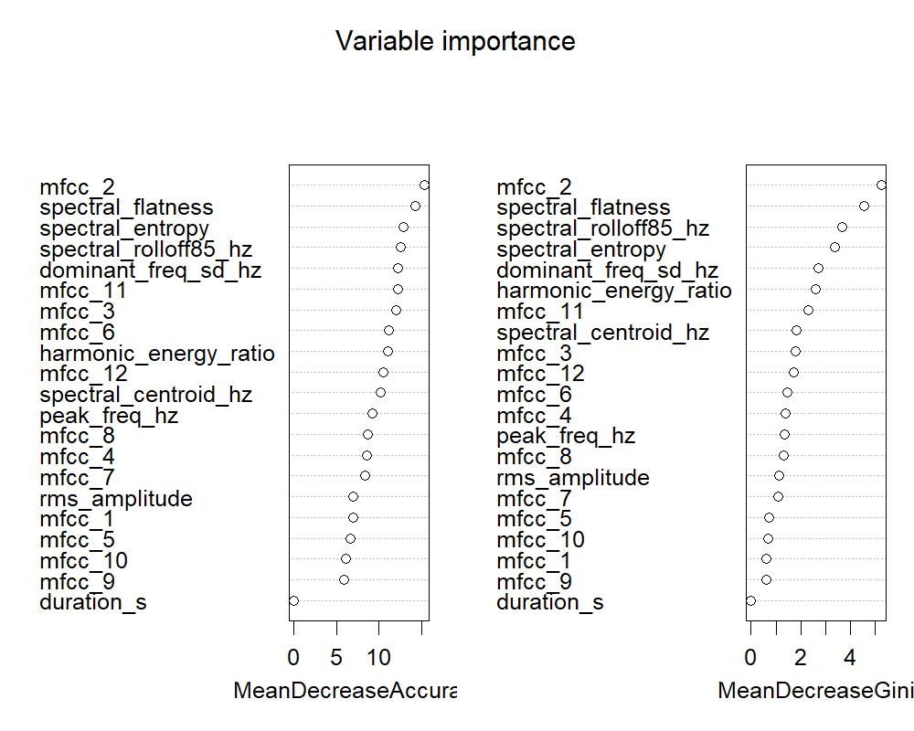

# Classifier Results

Generated by `R/05_train.R` on 2026-07-29 20:03. These are measured numbers from an actual train/test run -- not estimates.

**Data origin in this run:** real=252, synthetic=48 windows. If `synthetic` dominates or `real` is 0, treat these results as synthetic-signal validation only, NOT as evidence of real-world field performance.

Split (by source recording, not window): 56 train / 18 val / 20 test source files.

## Class counts (windows, all splits)

|   |label                       |data_origin | Freq|
|:--|:---------------------------|:-----------|----:|
|1  |ambient                     |real        |  252|
|6  |ambient                     |synthetic   |   10|
|7  |synthetic_chewing_pulses    |synthetic   |   10|
|8  |synthetic_mosquito_wingbeat |synthetic   |   10|
|9  |synthetic_stridulation      |synthetic   |   10|
|10 |synthetic_tone_plus_noise   |synthetic   |    8|

## Confusion matrix (test set; rows = predicted, columns = actual)

|                            |predicted_class             | ambient| synthetic_chewing_pulses| synthetic_mosquito_wingbeat| synthetic_stridulation| synthetic_tone_plus_noise|
|:---------------------------|:---------------------------|-------:|------------------------:|---------------------------:|----------------------:|-------------------------:|
|ambient                     |ambient                     |      40|                        0|                           0|                      0|                         4|
|synthetic_chewing_pulses    |synthetic_chewing_pulses    |       0|                        2|                           0|                      0|                         0|
|synthetic_mosquito_wingbeat |synthetic_mosquito_wingbeat |       0|                        0|                           2|                      0|                         0|
|synthetic_stridulation      |synthetic_stridulation      |       0|                        0|                           0|                      2|                         0|
|synthetic_tone_plus_noise   |synthetic_tone_plus_noise   |       0|                        0|                           0|                      0|                         0|

## Per-class precision / recall (test set)

|class                       | precision| recall|
|:---------------------------|---------:|------:|
|ambient                     |     0.909|      1|
|synthetic_chewing_pulses    |     1.000|      1|
|synthetic_mosquito_wingbeat |     1.000|      1|
|synthetic_stridulation      |     1.000|      1|
|synthetic_tone_plus_noise   |        NA|      0|

## False-positive rate against the ambient/negative class

**0%** of true ambient test windows were misclassified as a pest (false alarm).

## Variable importance

## Interpretation

TBD -- fill in after reading the numbers above. If performance is poor 
for any class (especially a target pest), say so plainly -- do not 
retune thresholds until the numbers look better before reporting them.
