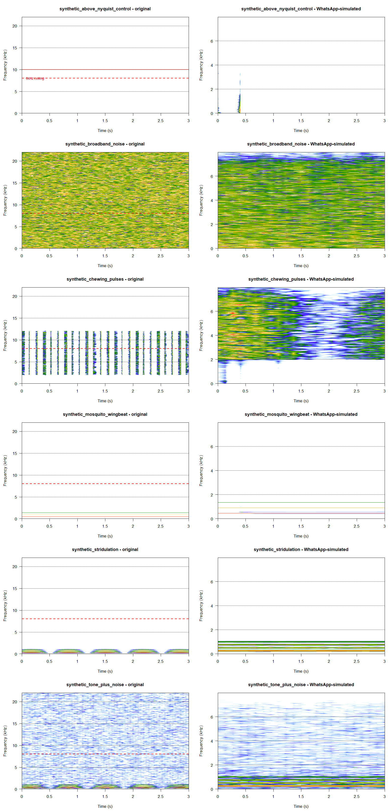

# Codec Findings: What Survives WhatsApp Compression

Generated by `R/02_codec_experiment.R`. These are measured numbers from an
actual Opus/Ogg round-trip simulation at WhatsApp's parameters
(16000 Hz, 16 kbps, mono),
not estimates. Re-run the script to regenerate this file from scratch.

## Signature survivability by species

|species                            | mean_survivability| mean_pearson| mean_cosine| n_files|
|:----------------------------------|------------------:|------------:|-----------:|-------:|
|real_chorthippus_biguttulus        |              0.986|        0.986|       0.987|       5|
|real_cicada_orni                   |              0.972|        0.967|       0.976|       5|
|synthetic_stridulation             |              0.969|        0.968|       0.970|       5|
|real_chorthippus_brunneus          |              0.956|        0.953|       0.960|       5|
|synthetic_tone_plus_noise          |              0.945|        0.929|       0.961|       4|
|synthetic_chewing_pulses           |              0.910|        0.858|       0.963|       5|
|real_chewing_diaprepes_abbreviatus |              0.892|        0.852|       0.932|       3|
|real_chewing_phyllophaga           |              0.823|        0.790|       0.856|       4|
|synthetic_mosquito_wingbeat        |              0.800|        0.799|       0.802|       5|
|real_chewing_plodia_interpunctella |              0.570|        0.503|       0.637|       2|
|synthetic_broadband_noise          |              0.510|        0.055|       0.964|       5|
|real_chewing_otiorhynchus_sulcatus |              0.398|        0.343|       0.453|       1|
|real_chewing_sitophilus_oryzae     |              0.342|        0.080|       0.603|       5|
|synthetic_above_nyquist_control    |              0.101|       -0.097|       0.298|       1|

## Per-frequency-band energy retention (degraded / original)

|species                            | 0-500Hz| 2-4kHz| 4-8kHz| 500Hz-2kHz| >8kHz|
|:----------------------------------|-------:|------:|------:|----------:|-----:|
|real_chewing_diaprepes_abbreviatus |   1.593|  1.687|  1.504|      1.788|    NA|
|real_chewing_otiorhynchus_sulcatus |   4.005|  5.812|  5.139|      6.730|    NA|
|real_chewing_phyllophaga           |   1.794|  2.356|  1.979|      2.982|    NA|
|real_chewing_plodia_interpunctella |   2.333| 10.382|  8.051|     11.829|    NA|
|real_chewing_sitophilus_oryzae     |   4.254| 21.343| 17.967|     22.665|    NA|
|real_chorthippus_biguttulus        |   0.910|  0.729|  0.592|      0.814|    NA|
|real_chorthippus_brunneus          |   0.914|  0.729|  0.654|      0.750|    NA|
|real_cicada_orni                   |   0.858|  0.871|  0.868|      0.894|    NA|
|synthetic_above_nyquist_control    |      NA|     NA|     NA|         NA|    NA|
|synthetic_broadband_noise          |   0.926|  0.786|  0.616|      0.898|    NA|
|synthetic_chewing_pulses           |      NA|  0.951|  0.822|      1.397|    NA|
|synthetic_mosquito_wingbeat        |   0.466|     NA|     NA|      0.687|    NA|
|synthetic_stridulation             |   0.700|     NA|     NA|      0.740|    NA|
|synthetic_tone_plus_noise          |   0.690|  0.635|  0.498|      0.706|    NA|

## Reading the >8kHz column

A retention value at or near 0 in the >8kHz band confirms the hard
Nyquist ceiling: content above 8 kHz cannot survive a 16 kHz-sample-rate
resample. It is not attenuated -- it is physically absent from the
degraded signal. This is expected and is not a pipeline bug.

## Reading NA retention cells

NA means the original signal had negligible energy in that band to
begin with (below 0.5% of its total spectral energy) -- e.g. the
0-500Hz column for a pure 10kHz tone. Computing a ratio there would
divide tiny leakage by near-zero, producing an arbitrarily large number
that isn't a real finding. Only cells with a value reflect a band the
source signal actually had meaningful energy in.

## A retention value above 1.0 is not creation of energy

(Prompt 11 bug fix, see `band_energy_density()` in `R/02_codec_experiment.R`
for the full account: per-band energy is now a MEAN over that band's
bins, not a raw sum -- summing raw bins previously inflated every
retention ratio by roughly the bin-count ratio between the original's
native sample rate and the degraded signal's 16kHz, since
`seewave::meanspec()` peak-normalizes each spectrum independently and a
lower sample rate packs more FFT bins into the same Hz range. This did
NOT affect the survivability scores above, which already used a
common-frequency-grid comparison unaffected by bin count -- only this
per-band table was wrong before this fix, systematically, for every
species, in every prior version of this document.)

A value above 1.0 after this fix is a real, legitimate reading: it means
a band gained ENERGY DENSITY RELATIVE TO THE ORIGINAL SIGNAL'S OWN LEVEL
IN THAT BAND -- typically because the original had very little energy
there (a narrowband/peaky source) and lossy compression filled the gap
with quantization noise, which is proportionally large relative to a
near-silent original even though it is quiet in absolute terms. This is
most visible for the chewing/feeding species below (contact-sensor
recordings with highly peaked, narrowband spectra) and is consistent
with, not contradictory to, their already-poor Pearson/cosine
survivability scores above -- both point the same direction: the
spectral SHAPE of these sources does not survive compression well.

## Before/after spectrogram panel

## Real WhatsApp round-trip check

See `docs/roundtrip_validation.md` (Prompt 11) for the full real-vs-
simulated validation -- generated only once real WhatsApp-exported
audio has been provided under
`data/codec_experiment/real_roundtrip/received/`; see
`docs/roundtrip_procedure.md` for the manual steps and
`R/10_roundtrip_validation.R` for the analysis, which supersedes the
older `compare_real_vs_simulated()` stub in this file (kept for
reference, not run by `main()` below any more).

## Interpretation

**Real Orthoptera/Cicadidae stridulation survives WhatsApp compression
 well, both in overall shape (survivability 0.956-0.986) and per-band
 (70-91% energy density retained in every sub-8kHz band for all three
 real target species) -- the two metrics agree, which is reassuring
 given the per-band metric had a real bug until this run.** The >8kHz
 ceiling is absolute for every species, synthetic or real, confirming
 the Nyquist-cut mechanism directly, not just inferring it from the
 sample rate.

**Real chewing/feeding sounds survive poorly-to-moderately in shape
 (survivability 0.342-0.892) and show the inverse per-band pattern**
 -- retention ratios well above 1.0 in every sub-8kHz band, which is
 the same underlying finding restated from the energy side: these
 contact-sensor recordings are narrowband/peaky, and 16kbps Opus fills
 their near-silent bands with proportionally large quantization noise
 rather than preserving their (already unusual, contact-sensor-
 specific) spectral shape. This class remains out of the classifier's
 scope (see `docs/methodology.md`) and this finding does not change
 that scoping decision -- if anything it reinforces it.
