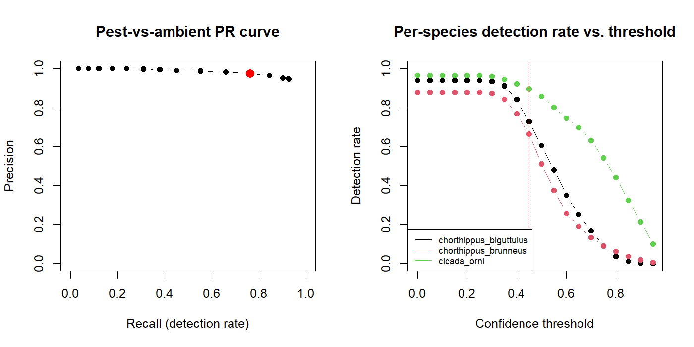

# Operating Point Analysis: Pest-vs-Ambient Decision

Generated by `R/08_operating_point.R` on 2026-08-04 22:33. Uses the SAME out-of-fold predictions the repeated k-fold CV accuracy numbers in `docs/classifier_results.md` come from (`data/processed/cv_predictions.csv`) -- not the final full-corpus model's own training predictions, which would be optimistic. Restricted to real audio (14040 real-class window-level test predictions, aggregated to 2750 clip-level predictions, across 275 source recordings); synthetic classes excluded as not part of the deployed scenario.

## Window-level vs. clip-level: why this distinction matters (Prompt 10)

`R/06_predict.R`'s `predict_pest()` never actually scores a single window in isolation --
 it windows an incoming voice note, gates near-silent windows, and AVERAGES the resulting
 class-probability vectors across every surviving window before deciding. Prompt 9's
 operating-point analysis swept a threshold over WINDOW-level out-of-fold predictions,
 which is not the curve the deployed system produces. This run builds both, using the
 exact same aggregation rule `predict_pest()` uses (mean of each window's full probability
 vector, then argmax + top confidence, grouped by source recording within each
 fold-evaluation) -- not an approximation of it.

**The result is more nuanced than "pooling makes everything better," and that nuance is
 itself worth reporting rather than smoothing over.** Overall clip-level accuracy IS
 higher (see docs/classifier_results.md) and clip-level false-positive rate IS lower at
 every threshold -- both consistent with pooling reducing noise. But clip-level PRECISION
 at a given threshold reads LOWER than window-level precision at that same threshold
 (e.g. 90.1% vs. 97.5% at 0.45), which looks contradictory until the reason is made
 explicit: **windows and clips are different populations with very different class
 balance, not just a noisier vs. a cleaner view of the same population.** Ambient
 recordings (ESC-50, uniformly 5 seconds) contribute few windows each; many real pest
 recordings run much longer and contribute up to the 20-window cap each. At window level
 this makes ambient a small minority of test UNITS (2630 of 14040, ~19%); at clip level
 ambient and pest are roughly balanced (1400 of 2750, ~51%). The SAME absolute
 false-positive rate costs precision far more when negatives are half the population than
 when they're a fifth of it -- so window-level precision was inflated by a class-balance
 artifact of window-count-per-recording, not a real property of the model being better at
 the window level. The clip-level number is the honest one, since a clip -- not a window
 -- is the unit that actually exists at inference time.

## Baselines (read every accuracy figure in this project against these)

- **Majority-class baseline**: always predicting `chorthippus_biguttulus` (the most common class) gets 
  **27.1%** accuracy on this data -- not 50%, because classes are imbalanced 
  (ambient dominates the corpus). Any classifier accuracy figure below this is worse than
  guessing the majority class every time.
- **Chance rate** (8 classes, uniform guessing): **12.5%**.

## Window-level vs. clip-level PR curves, side by side

ALERT = (predicted class is not ambient) AND (confidence >= threshold) -- this is exactly 
what `R/06_predict.R`'s `low_confidence` flag already gates.

|threshold |window_precision |window_recall |window_fpr |clip_precision |clip_recall |clip_fpr |
|:---------|:----------------|:-------------|:----------|:--------------|:-----------|:--------|
|0.00      |94.7%            |92.8%         |22.4%      |80.1%          |89.7%       |21.4%    |
|0.05      |94.7%            |92.8%         |22.4%      |80.1%          |89.7%       |21.4%    |
|0.10      |94.7%            |92.8%         |22.4%      |80.1%          |89.7%       |21.4%    |
|0.15      |94.7%            |92.8%         |22.4%      |80.1%          |89.7%       |21.4%    |
|0.20      |94.7%            |92.8%         |22.4%      |80.1%          |89.7%       |21.4%    |
|0.25      |94.7%            |92.8%         |22.3%      |80.1%          |89.7%       |21.4%    |
|0.30      |94.8%            |92.3%         |21.8%      |80.3%          |89%         |21.1%    |
|0.35      |95.3%            |89.9%         |19.1%      |82%            |85.6%       |18.1%    |
|0.40      |96.4%            |84.5%         |13.8%      |85.9%          |79.8%       |12.6%    |
|0.45      |97.5%            |76.2%         |8.5%       |90.1%          |72.7%       |7.7%     |
|0.50      |98.2%            |65.8%         |5.3%       |92%            |60.7%       |5.1%     |
|0.55      |98.7%            |55.2%         |3.2%       |94.5%          |49.3%       |2.8%     |
|0.60      |99%              |45%           |2%         |96%            |37.3%       |1.5%     |
|0.65      |99.5%            |37.9%         |0.8%       |97.1%          |29.9%       |0.9%     |
|0.70      |99.7%            |30.9%         |0.3%       |99.1%          |24.4%       |0.2%     |
|0.75      |99.9%            |23.9%         |0.1%       |100%           |18.7%       |0%       |
|0.80      |100%             |17.7%         |0%         |100%           |13.3%       |0%       |
|0.85      |100%             |12.2%         |0%         |100%           |9.2%        |0%       |
|0.90      |100%             |7.6%          |0%         |100%           |5.2%        |0%       |
|0.95      |100%             |3.4%          |0%         |100%           |2.8%        |0%       |

**The window-vs-clip gap is itself a result: at threshold 0.45, clip-level FPR is 7.7% vs. window-level 8.5%** -- 
this quantifies how much multi-window pooling actually buys at the unit a farmer experiences, 
which justifies `predict_pest()`'s pooling design rather than just asserting it helps. Precision 
at that same threshold reads lower at clip level (see the class-balance explanation above) -- 
read FPR, not precision, as the pooling-benefit number specifically, since precision also moves 
with the population's class balance, which differs between windows and clips for reasons unrelated 
to pooling.

**Recall (detection rate) is also slightly lower at clip level (72.7% vs. window-level 76.2% at 
threshold 0.45) -- unlike precision, this is a genuine (small) pooling cost, not a 
class-balance artifact: averaging a clip's windows can dilute one strongly-confident correct 
window with other, weaker or wrong-favouring windows from the same clip, occasionally pulling 
the pooled confidence for a real pest clip below threshold when its single best window would 
have cleared it. Net effect at the chosen threshold: fewer false alarms, slightly fewer true 
detections too -- both real, and both part of the honest trade this operating point makes.

## Per-species clip-level detection rate at each threshold

|threshold |chorthippus_biguttulus |chorthippus_brunneus |cicada_orni |
|:---------|:----------------------|:--------------------|:-----------|
|0.00      |90.9%                  |81.8%                |96.4%       |
|0.05      |90.9%                  |81.8%                |96.4%       |
|0.10      |90.9%                  |81.8%                |96.4%       |
|0.15      |90.9%                  |81.8%                |96.4%       |
|0.20      |90.9%                  |81.8%                |96.4%       |
|0.25      |90.9%                  |81.8%                |96.4%       |
|0.30      |90.4%                  |80.7%                |96%         |
|0.35      |87.6%                  |75.6%                |93.6%       |
|0.40      |81.1%                  |67.6%                |90.7%       |
|0.45      |70.7%                  |58.7%                |88.7%       |
|0.50      |55.8%                  |42%                  |84.4%       |
|0.55      |43.8%                  |28.4%                |75.8%       |
|0.60      |27.1%                  |16.4%                |68.2%       |
|0.65      |16.2%                  |10.7%                |62.7%       |
|0.70      |9.6%                   |7.3%                 |56.4%       |
|0.75      |4%                     |5.3%                 |46.9%       |
|0.80      |2%                     |3.1%                 |34.7%       |
|0.85      |0.2%                   |1.1%                 |26.2%       |
|0.90      |0%                     |0.2%                 |15.3%       |
|0.95      |0%                     |0%                   |8.4%        |

## Windows per clip after energy gating (context for how much pooling actually helps in practice)

min=1, p25=2, median=2, p75=6, max=20 (n=299 recordings, compressed arm).

**Caveat that belongs alongside the clip-level numbers above:** this corpus's windows-
per-recording distribution is dominated by real field recordings, some many seconds to 
minutes long -- a 10-30 second farmer voice note (the length the webhook actually asks 
for) will yield fewer usable windows after gating than the median recording here, closer 
to the LOW end of this distribution. If a real inbound clip yields only 2-3 usable 
windows, the clip-level pooling advantage shown above will be smaller in practice than 
this analysis suggests, since pooling variance reduction scales with the number of
windows pooled.

## Chosen operating point (from the CLIP-level curve)

**Threshold = 0.45.** At this threshold (clip-level): precision 90.1%, recall (detection rate) 72.7%, 
false-positive rate 7.7% (target: at or below 10%).

**Rationale (a deployment decision, not a metric-dump default):** this is a screening tool 
a farmer acts on directly -- a false alarm (an alert on real ambient noise) costs trust 
immediately and repeatedly, and enough of them means the farmer stops trusting alerts at 
all, at which point the system has no value regardless of how good its detection rate is 
on paper. A missed detection costs one skipped alert, and the system's own low-confidence 
reply already asks the farmer to resend a longer/louder recording -- a real, if imperfect, 
recovery path that a false alarm has no equivalent of. This asymmetry is why the threshold 
is chosen to hold false-positive rate at or below 10%, accepting whatever recall cost that 
requires, rather than picking a threshold that maximises accuracy or F1. Chosen from the 
CLIP-level curve specifically (Prompt 10), not the window-level curve (Prompt 9's original 
choice), since a clip -- one voice note in, one prediction out -- is the unit a farmer 
actually experiences.

This threshold is now `R/06_predict.R`'s `LOW_CONFIDENCE_THRESHOLD` default, and the 
webhook's low-confidence reply path uses it directly -- what the farmer receives now 
matches what this analysis reports, not a separate unexamined number.

## Precision as a function of true pest prevalence (Prompt 11, Part 3)

This corpus's clip-level class balance is **49.1% pest / 50.9% ambient** (1350 of 2750 clips)
 -- an artifact of how this project sampled real recordings (45 recordings per real target
 species, 145 ambient), NOT a claim about what fraction of real farm nighttime recordings
 actually contain a target pest. Precision at a fixed recall/false-positive-rate is NOT
 independent of the true prevalence of the condition being screened for -- standard
 screening-test arithmetic:

`precision(p) = (recall * p) / (recall * p + fpr * (1 - p))`

using this threshold's recall (72.7%) and false-positive rate (7.7%):

|assumed_prevalence |precision |
|:------------------|:---------|
|1%                 |8.7%      |
|5%                 |33.1%     |
|10%                |51.1%     |
|25%                |75.8%     |
|50%                |90.4%     |

**Self-check: does the formula reproduce the actually-measured precision at this corpus's own prevalence?** At the corpus's exact measured prevalence (49.1%, not the rounded 50% row above), the formula gives 90.1% precision; the actually-reported clip-level precision is 90.1% (difference: 0%). **Matches within rounding -- the formula and the underlying rates are consistent.**

**Why this table matters more than any single precision number:** at 1% assumed prevalence
 (closer to what an unselected nighttime farm recording might plausibly be, though this
 project has no real measurement of that rate either), precision collapses -- most alerts
 would be false alarms, because false alarms scale with the much larger pool of true
 negatives while true detections scale with a small pool of true positives. This is exactly
 why this system is positioned as a **screening tool a farmer still exercises judgement
 on**, not an autonomous alert trigger that acts without a human in the loop -- the
 corpus's ~50/50 balance is not deployment-representative, and presenting the 90.1% figure
 alone without this table would overstate what a farmer should expect at low real-world
 prevalence.

**Temporal persistence as future work:** repeated sampling from the same location over time
 (e.g. several voice notes from the same field over a few nights) would raise EFFECTIVE
 precision beyond any single-clip number in this table, since independent false alarms are
 unlikely to repeatedly and consistently point at the same pest across multiple separate
 recordings, while a genuine infestation would. This project has not implemented or measured
 that -- it is a stated direction for future work, not a claim made here.
