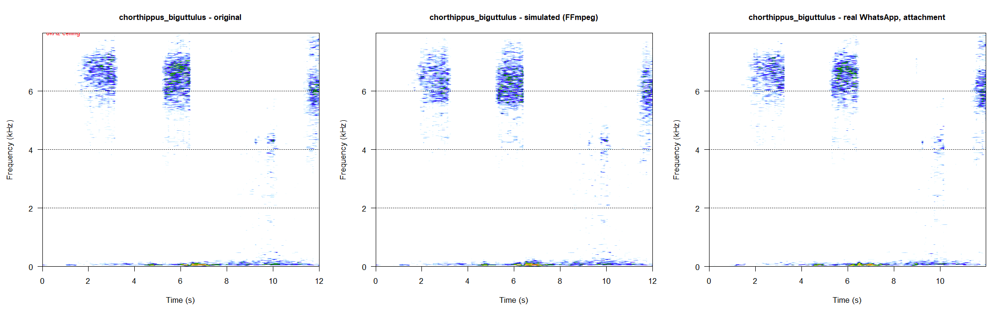
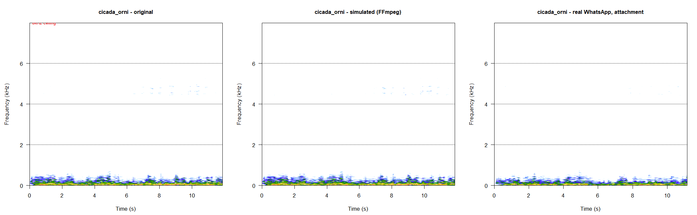
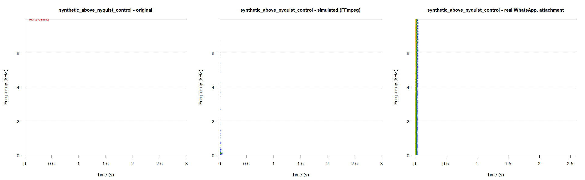
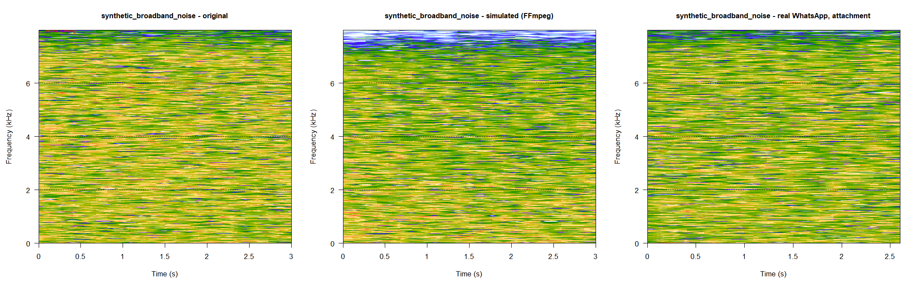
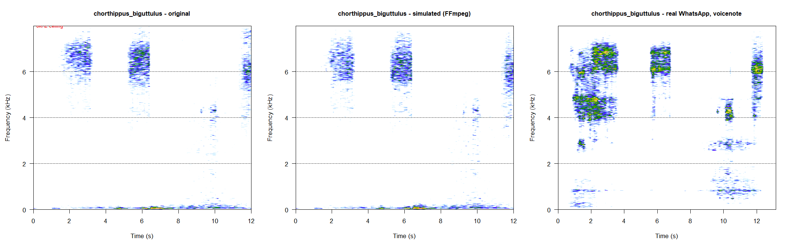
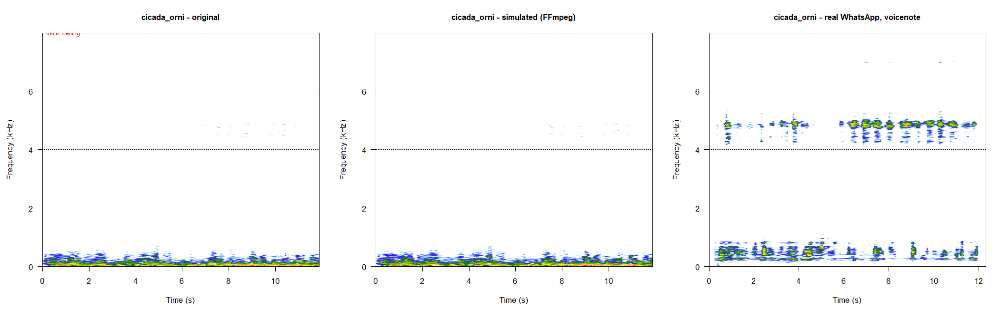
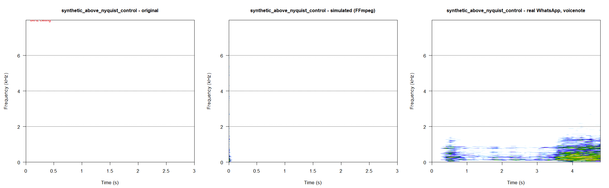
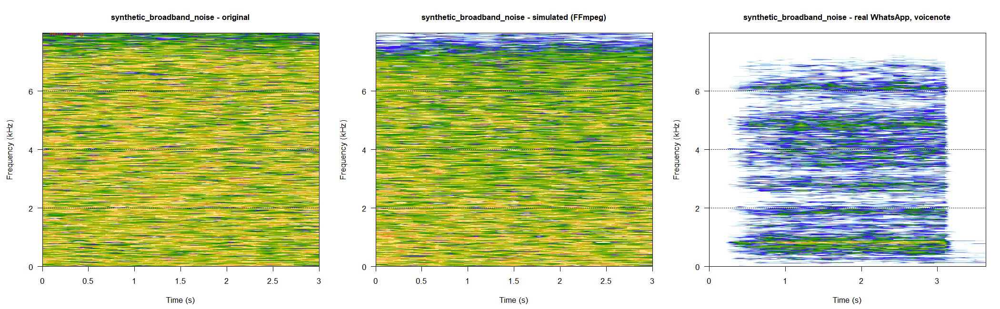

# Real WhatsApp Round-Trip Validation

Generated by `R/10_roundtrip_validation.R` on 2026-10-21 13:03. Compares our local FFmpeg simulation of WhatsApp's Opus/Ogg compression against TWO real WhatsApp round trips on the same source clips: a file-attachment send (codec isolation) and a played-aloud-and-recorded voice note (the actual deployment path). See `docs/roundtrip_procedure.md` for exactly how the real files were produced.

## Tolerance, stated before any real data was collected

- **PASS**: real-vs-simulated spectral correlation >= 0.90 AND mean per-band retention divergence <= 0.10
- **CAUTION**: correlation >= 0.75 AND divergence <= 0.20 (and not PASS)
- **FAIL**: anything worse than CAUTION

Applied identically to both arms below -- one pre-registered bar, not two. The **voice-note arm's 
verdict is the headline one** (it's the actual deployment path); the attachment arm's verdict is 
diagnostic. These thresholds are copied verbatim from this script's own header comment, written 
before any received file existed -- not adjusted after seeing the numbers below.

## Experiment 1: File-attachment round trip (codec isolation)

Each `sent_NN_*.wav` sent as a file/audio ATTACHMENT (not a recorded voice note) -- no speaker, no microphone, no room acoustics involved. Isolates whatever WhatsApp's attachment transport does to the file on its own.

All sent files had a matching received file for this arm.

### Actual encoding parameters (from the received file, via ffprobe)

|id |label                           |codec | decoded_sample_rate_hz| channels| bitrate_kbps|energy_above_8kHz_original |energy_above_8kHz_received |
|:--|:-------------------------------|:-----|----------------------:|--------:|------------:|:--------------------------|:--------------------------|
|01 |chorthippus_biguttulus          |aac   |                  44100|        1|        100.3|42.5%                      |41.8%                      |
|02 |cicada_orni                     |aac   |                  44100|        1|         99.3|0%                         |0%                         |
|03 |synthetic_above_nyquist_control |aac   |                  44100|        1|         98.4|100%                       |100%                       |
|04 |synthetic_broadband_noise       |aac   |                  44100|        1|         99.3|60.6%                      |52.3%                      |

`decoded_sample_rate_hz` is what ffprobe reports; Opus always decodes at 48000 Hz whatever bandwidth was encoded, so it can't show the assumed 16000 Hz / 8 kHz ceiling. The two `energy_above_8kHz` columns measure that directly, at each file's native rate. Assumed WhatsApp parameters: 16000 Hz, 16 kbps.

Everything below is compared at 16000 Hz mono -- original, simulated and real alike -- the rate the classifier is trained and served at.

### Per-file results

#### 01_chorthippus_biguttulus

- Real round-trip survivability (this arm): 0.988 (Pearson 0.981, cosine 0.995)
- Simulated round-trip survivability: 0.983 (Pearson 0.973, cosine 0.992)
- **Simulation fidelity (real vs. simulated, directly): Pearson 0.962, cosine 0.989**
- Mean per-band retention divergence: 0.190

|band       |real_retention |simulated_retention |abs_divergence |
|:----------|:--------------|:-------------------|:--------------|
|0-500Hz    |119.8%         |106.4%              |13.3%          |
|500Hz-2kHz |121.5%         |101.6%              |19.9%          |
|2-4kHz     |118.8%         |99.2%               |19.5%          |
|4-8kHz     |118.7%         |95.3%               |23.4%          |

**Verdict: CAUTION**

#### 02_cicada_orni

- Real round-trip survivability (this arm): 0.998 (Pearson 0.998, cosine 0.998)
- Simulated round-trip survivability: 0.999 (Pearson 0.999, cosine 0.999)
- **Simulation fidelity (real vs. simulated, directly): Pearson 0.997, cosine 0.997**
- Mean per-band retention divergence: 0.099

|band       |real_retention |simulated_retention |abs_divergence |
|:----------|:--------------|:-------------------|:--------------|
|0-500Hz    |97.3%          |101.3%              |4%             |
|500Hz-2kHz |97.6%          |107.6%              |10.1%          |
|2-4kHz     |92.6%          |105.9%              |13.2%          |
|4-8kHz     |93.7%          |106.3%              |12.5%          |

**Verdict: PASS**

#### 03_synthetic_above_nyquist_control

- Real round-trip survivability (this arm): 0.804 (Pearson 0.884, cosine 0.724)
- Simulated round-trip survivability: 0.021 (Pearson -0.211, cosine 0.254)
- **Simulation fidelity (real vs. simulated, directly): Pearson -0.278, cosine 0.608**
- Mean per-band retention divergence: 9.964

|band       |real_retention |simulated_retention |abs_divergence |
|:----------|:--------------|:-------------------|:--------------|
|0-500Hz    |1866.1%        |818%                |1048.1%        |
|500Hz-2kHz |1443%          |214.6%              |1228.4%        |
|2-4kHz     |1703.6%        |175.2%              |1528.5%        |
|4-8kHz     |192.4%         |11.6%               |180.8%         |

**Verdict: N/A (most of this file's energy is above 8 kHz; see the >8 kHz columns instead)**

#### 04_synthetic_broadband_noise

- Real round-trip survivability (this arm): 0.828 (Pearson 0.665, cosine 0.992)
- Simulated round-trip survivability: 0.858 (Pearson 0.731, cosine 0.984)
- **Simulation fidelity (real vs. simulated, directly): Pearson 0.680, cosine 0.982**
- Mean per-band retention divergence: 0.078

|band       |real_retention |simulated_retention |abs_divergence |
|:----------|:--------------|:-------------------|:--------------|
|0-500Hz    |97.6%          |97.9%               |0.3%           |
|500Hz-2kHz |94.2%          |93.7%               |0.4%           |
|2-4kHz     |91.2%          |81.5%               |9.7%           |
|4-8kHz     |91%            |70.3%               |20.6%          |

**Verdict: FAIL**

## Experiment 2: Voice-note record round trip (deployment path)

Each `sent_NN_*.wav` played out loud and re-recorded as a real WhatsApp voice note (mic button, in-app). This is the actual deployment path and bundles acoustic-capture loss (speaker, room, phone mic) together with whatever codec compression WhatsApp applies to voice notes.

All sent files had a matching received file for this arm.

### Actual encoding parameters (from the received file, via ffprobe)

|id |label                           |codec | decoded_sample_rate_hz| channels| bitrate_kbps|energy_above_8kHz_original |energy_above_8kHz_received |
|:--|:-------------------------------|:-----|----------------------:|--------:|------------:|:--------------------------|:--------------------------|
|01 |chorthippus_biguttulus          |opus  |                  48000|        1|         17.4|42.5%                      |0.6%                       |
|02 |cicada_orni                     |opus  |                  48000|        1|         18.7|0%                         |0%                         |
|03 |synthetic_above_nyquist_control |opus  |                  48000|        1|         16.5|100%                       |0%                         |
|04 |synthetic_broadband_noise       |opus  |                  48000|        1|         17.9|60.6%                      |0.1%                       |

`decoded_sample_rate_hz` is what ffprobe reports; Opus always decodes at 48000 Hz whatever bandwidth was encoded, so it can't show the assumed 16000 Hz / 8 kHz ceiling. The two `energy_above_8kHz` columns measure that directly, at each file's native rate. Assumed WhatsApp parameters: 16000 Hz, 16 kbps.

Everything below is compared at 16000 Hz mono -- original, simulated and real alike -- the rate the classifier is trained and served at.

### Per-file results

#### 01_chorthippus_biguttulus

- Real round-trip survivability (this arm): 0.566 (Pearson 0.331, cosine 0.802)
- Simulated round-trip survivability: 0.983 (Pearson 0.973, cosine 0.992)
- **Simulation fidelity (real vs. simulated, directly): Pearson 0.295, cosine 0.788**
- Mean per-band retention divergence: 1.050

|band       |real_retention |simulated_retention |abs_divergence |
|:----------|:--------------|:-------------------|:--------------|
|0-500Hz    |59.1%          |106.4%              |47.3%          |
|500Hz-2kHz |244.8%         |101.6%              |143.3%         |
|2-4kHz     |183.2%         |99.2%               |83.9%          |
|4-8kHz     |240.6%         |95.3%               |145.3%         |

**Verdict: FAIL**

#### 02_cicada_orni

- Real round-trip survivability (this arm): 0.225 (Pearson 0.175, cosine 0.275)
- Simulated round-trip survivability: 0.999 (Pearson 0.999, cosine 0.999)
- **Simulation fidelity (real vs. simulated, directly): Pearson 0.184, cosine 0.286**
- Mean per-band retention divergence: 6.242

|band       |real_retention |simulated_retention |abs_divergence |
|:----------|:--------------|:-------------------|:--------------|
|0-500Hz    |124.6%         |101.3%              |23.3%          |
|500Hz-2kHz |1148.7%        |107.6%              |1041.1%        |
|2-4kHz     |529.9%         |105.9%              |424.1%         |
|4-8kHz     |1114.8%        |106.3%              |1008.5%        |

**Verdict: FAIL**

#### 03_synthetic_above_nyquist_control

- Real round-trip survivability (this arm): -0.119 (Pearson -0.287, cosine 0.049)
- Simulated round-trip survivability: 0.021 (Pearson -0.211, cosine 0.254)
- **Simulation fidelity (real vs. simulated, directly): Pearson 0.403, cosine 0.576**
- Mean per-band retention divergence: 2.344

|band       |real_retention |simulated_retention |abs_divergence |
|:----------|:--------------|:-------------------|:--------------|
|0-500Hz    |1490.3%        |818%                |672.3%         |
|500Hz-2kHz |376.5%         |214.6%              |161.9%         |
|2-4kHz     |81.5%          |175.2%              |93.7%          |
|4-8kHz     |2%             |11.6%               |9.6%           |

**Verdict: N/A (most of this file's energy is above 8 kHz; see the >8 kHz columns instead)**

#### 04_synthetic_broadband_noise

- Real round-trip survivability (this arm): 0.597 (Pearson 0.338, cosine 0.857)
- Simulated round-trip survivability: 0.858 (Pearson 0.731, cosine 0.984)
- **Simulation fidelity (real vs. simulated, directly): Pearson 0.503, cosine 0.881**
- Mean per-band retention divergence: 0.627

|band       |real_retention |simulated_retention |abs_divergence |
|:----------|:--------------|:-------------------|:--------------|
|0-500Hz    |19.5%          |97.9%               |78.4%          |
|500Hz-2kHz |33.5%          |93.7%               |60.2%          |
|2-4kHz     |21%            |81.5%               |60.4%          |
|4-8kHz     |18.8%          |70.3%               |51.6%          |

**Verdict: FAIL**

## Isolating codec loss from acoustic-path loss

Comparing the same source clip's attachment-arm and voice-note-arm survivability 
directly answers what each transmission path actually costs.

|id |label                           | attachment_survivability| attachment_vs_original_pearson| voicenote_survivability| voicenote_vs_original_pearson| delta_survivability|
|:--|:-------------------------------|------------------------:|------------------------------:|-----------------------:|-----------------------------:|-------------------:|
|01 |chorthippus_biguttulus          |                    0.988|                          0.981|                   0.566|                         0.331|               0.422|
|02 |cicada_orni                     |                    0.998|                          0.998|                   0.225|                         0.175|               0.773|
|03 |synthetic_above_nyquist_control |                    0.804|                          0.884|                  -0.119|                        -0.287|               0.923|
|04 |synthetic_broadband_noise       |                    0.828|                          0.665|                   0.597|                         0.338|               0.231|

**Mixed result** -- 2 of 4 files' attachment arm looks like a near-lossless passthrough and the rest show real degradation. The codec-vs-acoustic decomposition below is only reliable file-by-file, not as a single blanket statement -- read the table, not just this paragraph.

## Overall verdict

*Written by hand on 2026-10-21 after reading the numbers above. Re-running
`R/10_roundtrip_validation.R` resets this section to TBD -- re-read the numbers and rewrite it.*

**Deployment path (voice-note arm, the headline): FAIL against the pre-registered bar for both
real species.** Simulation fidelity is Pearson 0.30 (*C. biguttulus*) and 0.18 (*Cicada orni*),
far below the 0.75 CAUTION bar; broadband noise also fails (0.50); the 10 kHz control gets no
spectral verdict. The local simulation does **not** reproduce what a played-aloud,
phone-recorded WhatsApp voice note looks like.

**What the real voice-note path changes (all measured at 16 kHz):**

- **The 8 kHz ceiling is real.** At most 0.6% of energy is above 8 kHz in every received voice
  note (originals: up to 100%). That assumption, and everything resting on it, holds.
- **The dominant peak survives, shifted slightly and broadened:** *Cicada orni* 4508 -> 4852 Hz
  (this round trip) and 4461 -> 4570 Hz (a separate voice note of the held-out
  `demo_clips/cicada_orni.wav`); *C. biguttulus* 6766 -> 6141 Hz.
- **Low frequencies change, in a direction that depends on the setup.** Relative to each file's
  own 2-8 kHz level, the held-out demo voice note gained about +10 dB at 250-1000 Hz (room and
  speaker), while `received_02` lost about 31 dB below 250 Hz (speaker or phone-mic roll-off).
- **The very large per-band ratios above (up to 1148%) overstate the change.** That metric
  scales each spectrum to its own peak, and a broadened peak inflates every other band. Against
  the 2-8 kHz band instead, `received_02`'s 500-1000 Hz level is essentially unchanged (-0.4 dB).
- These are **acoustic-path** effects (speaker, room, phone microphone), which a codec-only
  simulation cannot model.

**Attachment arm (diagnostic): not a codec isolation after all.** WhatsApp re-encodes file
attachments as AAC at about 100 kbps / 44.1 kHz and keeps content above 8 kHz -- a different
codec from voice notes, close to lossless here (*Cicada orni* PASS, 0.997; *C. biguttulus*
CAUTION, 0.962 with a near-uniform band offset). So this data cannot separate voice-note codec
loss from acoustic loss. The broadband-noise attachment FAIL reflects Pearson correlation's
weakness on flat spectra (cosine 0.98), not real damage.

**What this means for earlier conclusions:**

- The codec survivability, compression-delta and classifier cross-validation numbers all measure
  the codec simulation applied to clean source audio. They remain valid as measurements of
  that, but they are **not** the deployment number: the real voice-note path is spectrally more
  destructive than simulated, because of the acoustic chain.
- Re-running the compression delta and classifier "with real round-trip parameters" is not
  possible by changing parameters: the extra loss is not a codec setting. It needs either an
  acoustic-path model or training audio recorded through real voice notes. Not done here.
- How the classifier actually does on these real voice notes (after the sample-rate fix in
  `R/06_predict.R`): *Cicada orni* correct both times -- the held-out demo clip at 90%, and
  `received_02` at 64% (a training recording, so optimistic) -- while `received_01`
  (*C. biguttulus*, also a training recording) comes out ambient 30%, low confidence. Three real
  voice notes are far too few to estimate deployment accuracy.
- `sent_01`/`sent_02` are WAV copies of training recordings, so classifier results on this round
  trip are optimistic; the held-out `demo_clips/` are the honest test audio.
